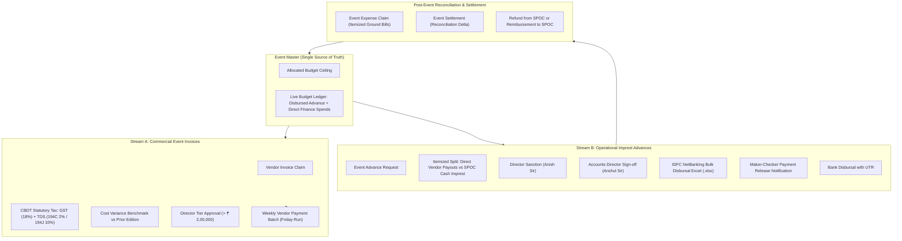
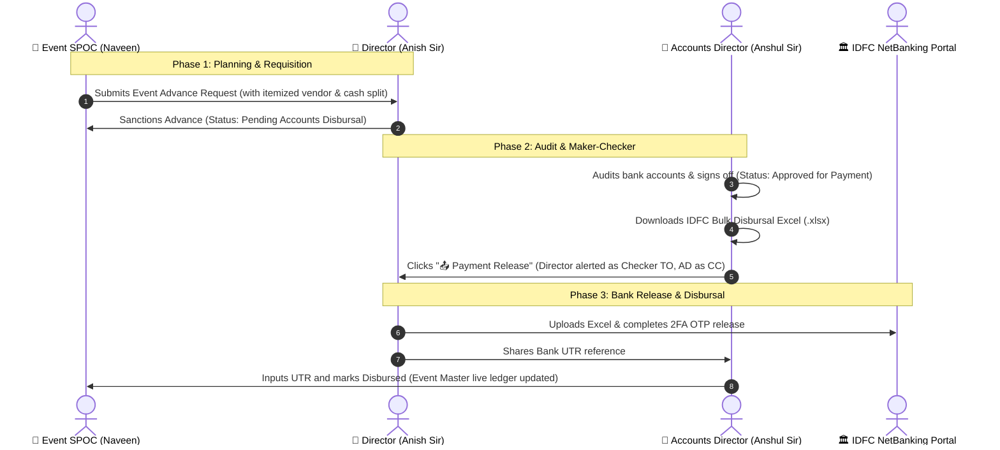
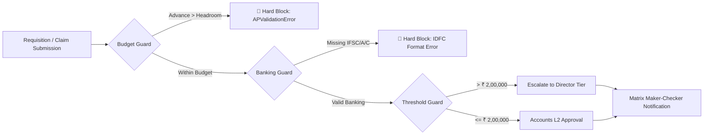

# Lane 4: Corporate Event Payments & Spends Automation
## Comprehensive Standard Operating Procedure (SOP) & User Acceptance Testing (UAT) Guide

**Target Environment:** ERPNext / Frappe (`hrms1.local`) & Cloud Production  
**Module:** Enterprise Accounts Payable (AP) Automation — Lane 4  
**App Repository:** `apps/ap_automation`  
**Target Audience:** Event Management Team (SPOCs), Executive Directors (Anish Sir), Accounts Directors (Anshul Sir), Finance & Audit Teams.  
**Version:** 4.2 (Production Ready)  
**Effective Date:** November 2026  

---

## 1. Executive Summary & Dual-Stream Architecture

Corporate events involve two fundamentally distinct types of expenditures that require different financial, legal, and banking pathways. To prevent compliance violations, double payouts, and untracked cash leakage, the platform enforces a strict **Dual-Stream Architecture**:



### The 2 Core Spend Streams:

| Dimension | Stream A: Commercial Event Invoices | Stream B: Event Imprest Advances |
| :--- | :--- | :--- |
| **Typical Spends** | Stage production, sound/audio-visual setups, hotel banquet venue rentals, LED screens, branding agencies. | Artist travel per-diem, local logistics, emcee token advances, promoters/usher fees, tea/coffee tips, local foam boards. |
| **Doctype Used** | `Vendor Invoice Claim` (linked to `event`) | `Event Advance Request` |
| **Tax Withholding** | Formal GST tax invoices with CBDT TDS withholding (Section 194C @ 2% for contractors, Section 194J @ 10% for professional). | No tax deduction on imprest advance; TDS handled separately if billed directly. |
| **Banking Flow** | Ingested into `Weekly Vendor Payment Batch` on Friday; paid to verified Supplier bank account via IDFC bulk disbursal. | On-demand IDFC bulk disbursal Excel (.xlsx) generated per advance, separating vendor bank rows and SPOC cash row. |
| **Benchmark Tracking**| Compares current quote against previous edition benchmark with cost variance savings % and scope justification. | Checked against available event budget ceiling headroom. |

---

## 2. DocType Master Catalog

The Event Payments subsystem consists of 6 tightly integrated DocTypes:

```
┌────────────────────────────────────────────────────────────────────────┐
│                              EVENT MASTER                              │
│         (Allocated Budget, Dates, Venue, SPOC, Live Spent Ledger)       │
└──────────────────┬──────────────────────────────────┬──────────────────┘
                   │                                  │
          [Stream A: Commercial]             [Stream B: Imprest]
                   ▼                                  ▼
      ┌─────────────────────────┐        ┌─────────────────────────┐
      │   VENDOR INVOICE CLAIM  │        │  EVENT ADVANCE REQUEST  │
      │ (GST, TDS, Benchmark,   │        │ (Itemized Vendor/Cash,  │
      │  Director Sign-off)     │        │  IDFC Excel Export)     │
      └────────────┬────────────┘        └────────────┬────────────┘
                   │                                  │
                   ▼                                  ▼
      ┌─────────────────────────┐        ┌─────────────────────────┐
      │  WEEKLY VENDOR BATCH    │        │   EVENT EXPENSE CLAIM   │
      │ (Consolidated Friday    │        │ (9-Bill Post-Event      │
      │  Vendor Run & UTR)      │        │  Spend Submission)      │
      └─────────────────────────┘        └────────────┬────────────┘
                                                      │
                                                      ▼
                                         ┌─────────────────────────┐
                                         │    EVENT SETTLEMENT     │
                                         │ (Advance vs Actuals,    │
                                         │  SPOC Cash Refund Delta)│
                                         └─────────────────────────┘
```

1. **`Event Master`**: Central controller holding event metadata, sanctioned budget, and real-time financial ledger (Disbursed Advances, Direct Finance Invoices, SPOC Ground Spends, Committed Spends, Remaining Budget, and Budget Overrun Status).
2. **`Event Advance Request`**: Pre-event requisition submitted by the SPOC with an itemized child table distinguishing direct vendor bank transfers from SPOC cash withdrawals.
3. **`Vendor Invoice Claim`**: Standard commercial invoice claim augmented with `event` linkage, `previous_benchmark_spend`, `cost_variance`, and `scope_variance_justification`.
4. **`Weekly Vendor Payment Batch`**: Aggregates approved commercial vendor invoices across events and general company operations into a single IDFC Excel payout file.
5. **`Event Expense Claim`**: Post-event expense submission by the SPOC itemizing all actual ground bills with attachments.
6. **`Event Settlement`**: Mathematical delta reconciliation comparing disbursed advances against approved actual claims to calculate the refund receivable from or payable to the SPOC.

---

## 3. Personas, Roles & Access Control

Governance strictly adheres to the **Zero-Trust Maker-Checker Rule** defined in the `AP Approval Matrix` (no hardcoded email addresses or generic roles).



| Persona | Real Representative | Core System Responsibilities | Primary Desk Actions |
| :--- | :--- | :--- | :--- |
| **Event SPOC** | Naveen Kumar K / Johnson / Event Team | 1. Creates `Event Master`.<br>2. Raises `Event Advance Request` with clear direct vendor vs cash split.<br>3. Collects bills and submits `Event Expense Claim`.<br>4. Refunds unspent cash and files `Event Settlement`. | `Save`, `Submit`, `New Expense Item`, `File Refund` |
| **Executive Director (Checker)** | Anish Sir (`anish@quanticus.com` / Matrix Checker) | 1. Sanctions event imprest advance proposals.<br>2. Reviews Cost Variance Benchmarks and approves commercial vendor claims > ₹ 2,00,000.<br>3. Receives one-click email alert for payment release.<br>4. Releases funds on IDFC NetBanking portal with 2FA OTP. | `✅ Sanction Imprest (Director)`, `Approve Director Tier`, Authorize Bank Portal |
| **Accounts Team (L1 / L2)** | Accounts Executives / Reviewers | 1. Audits vendor tax invoices, GSTIN, PAN, and SAC/HSN codes.<br>2. Verifies supplier bank details and penny-drop status.<br>3. Audits post-event claim bills and receipts. | `Verify Tax & Bank`, `Approve Accounts L1/L2` |
| **Accounts Director (Maker)** | Anshul Sir (`anshul@quanticus.com` / Matrix Supervisor) | 1. Signs off on sanctioned advances (`authorize_event_advance_by_accounts_director`).<br>2. Downloads official IDFC Bulk Disbursal Excel (.xlsx).<br>3. Clicks `📤 Payment Release` to alert the Director.<br>4. Records UTR upon banking confirmation. | `⭐ Accounts Director Sign-Off`, `🏛️ IDFC Bank Disbursal Excel`, `📤 Payment Release`, `💳 Release Bank Disbursal` |

---

## 4. End-to-End Step-by-Step Operating Procedures

### Phase 1: Event Master Creation & Budget Setup
* **Who:** Event SPOC (e.g. Naveen Kumar K)
* **DocType:** `Event Master`

1. Open **AP Automation** > **Event Masters** > Click **+ Add Event Master**.
2. Fill mandatory fields:
   * **Event Name:** e.g., `The Aionion Ascend | Welcomhotel ITC` or `Money Pechu New Book Launch - Chennai`.
   * **Company:** Select the corporate entity (e.g., `Aionion Capital Market Services Private Limited`).
   * **Event SPOC:** Select Frappe user ID of the ground manager.
   * **Start Date / End Date:** Event dates.
   * **Event Location:** e.g., `Welcomhotel by ITC, Chennai`.
   * **Allocated Budget:** Sanctioned event budget ceiling (e.g., `₹ 10,00,000.00` or `₹ 2,00,000.00`).
3. Click **Save**. The Event Master generates a live financial summary card:
   * Allocated Budget: `₹ 2,00,000.00`
   * Disbursed Advances: `₹ 0.00`
   * Direct Finance Spends: `₹ 0.00`
   * Total Committed Spends: `₹ 0.00`
   * Remaining Budget: `₹ 2,00,000.00`
   * Utilization: `0.00%` | Status: `WITHIN_BUDGET`

---

### Phase 2: Stream B — Event Advance Request (Imprest Proposal)
* **Who:** Event SPOC ➔ Director (Anish Sir) ➔ Accounts Director (Anshul Sir)
* **DocType:** `Event Advance Request`
* **Real Example:** *Money Pechu New Book Launch in Chennai (September 26, 2026)*

```
Email Proposal from Event Team:
"For Money Pechu New Book Launch, request imprest amount of ₹ 51,250 to respective vendor 
accounts, and ₹ 15,500 cash expenses to events management account. Total ₹ 66,750."
```

#### Step 1: Requisition Creation (Event SPOC)
1. Navigate to **Event Advance Request** > Click **+ Add Event Advance Request**.
2. Select the **Event**: Links to `Event Master`.
3. Fill SPOC Bank Details (used for cash imprest transfer):
   * **Bank Name:** `Equitas Small Finance Bank`
   * **Bank Account Number:** `100005849790`
   * **Bank IFSC Code:** `ESFB0001158`
4. In the **Imprest Items** table, enter itemized rows:
   * **Row 1 (Vendor):**
     * Particulars: `Hi Tea, Furniture, Stage backdrop, Welcome backdrop, Vallet parking`
     * Payment Mode: `Direct Vendor Payment`
     * Beneficiary Name: `THARANI.R`
     * Bank Name: `Indian Overseas Bank`
     * Bank Account Number: `108301000012513`
     * Bank IFSC Code: `IOBA0001083`
     * Amount: `₹ 31,750.00`
   * **Row 2 (Vendor):**
     * Particulars: `Production Elements`
     * Payment Mode: `Direct Vendor Payment`
     * Beneficiary Name: `A. Sathyanarayanan`
     * Bank Name: `Indian Overseas Bank`
     * Bank Account Number: `108301000018743`
     * Bank IFSC Code: `IOBA0001083`
     * Amount: `₹ 7,500.00`
   * **Row 3 (Vendor):**
     * Particulars: `Direct payment for MC Anchor`
     * Payment Mode: `Direct Vendor Payment`
     * Beneficiary Name: `MC Anchor`
     * Bank Name: `Canara Bank`
     * Bank Account Number: `110235650233`
     * Bank IFSC Code: `CNRB0001262`
     * Amount: `₹ 12,000.00`
   * **Row 4 (Cash):**
     * Particulars: `Foam Board, Miscellaneous, Promoters, and Usher girls`
     * Payment Mode: `Cash / Petty Imprest`
     * Beneficiary Name: `Naveen Kumar K`
     * Amount: `₹ 15,500.00`
5. The system automatically calculates:
   * Total Direct Vendor Amount: `₹ 51,250.00`
   * Total Cash Imprest Amount: `₹ 15,500.00`
   * Total Requested Advance: `₹ 66,750.00`
6. Click **Save** > **Submit**. Status becomes `Pending Business Head Sanction`.

#### Step 2: Director Sanction (Anish Sir)
1. Anish Sir opens the document from desk or email link.
2. The UI renders the **Event Context & Imprest Split Card**:
   ```
   ========================================================================
   Event: Money Pechu New Book Launch | Budget: ₹ 2,00,000.00
   🏢 Direct Vendor Transfers: ₹ 51,250.00 | 💵 Cash Imprest to SPOC: ₹ 15,500.00
   Total Imprest Proposed: ₹ 66,750.00
   ========================================================================
   ```
3. Anish Sir reviews the itemized table and clicks **`✅ Sanction Imprest (Director)`**.
4. Enters approval comment: *"Approved as requested for Money Pechu book launch."*
5. Document status updates to **`Pending Accounts Disbursal`**.

#### Step 3: Accounts Director Sign-off (Anshul Sir)
1. Anshul Sir audits the beneficiary bank accounts and IFSC codes.
2. Clicks **`⭐ Accounts Director Sign-Off`**.
3. Remarks: *"Bank details and beneficiary credentials audited. Approved."*
4. Status transitions to **`Approved for Payment`**.

#### Step 4: IDFC Excel Generation & Maker-Checker Alert
1. Anshul Sir clicks **`🏛️ IDFC Bank Disbursal Excel (.xlsx)`**.
2. System immediately validates all rows and downloads the file:
   `IDFC_Event_Advance_EAR-2026-11-03834_2026-11-06.xlsx`
3. Structure of generated IDFC Excel:

| Beneficiary Name | Beneficiary Account | IFSC Code | Payment Type | Debit Account | Value Date | Amount (INR) | Narration |
| :--- | :--- | :--- | :---: | :--- | :---: | :---: | :--- |
| **THARANI.R** | `108301000012513` | `IOBA0001083` | NEFT | `10173678610` | 06/11/2026 | `31750.00` | EVT-ADV EAR-03834 Hi Tea |
| **A. SATHYANARAYANAN** | `108301000018743` | `IOBA0001083` | NEFT | `10173678610` | 06/11/2026 | `7500.00` | EVT-ADV EAR-03834 Prod |
| **MC ANCHOR** | `110235650233` | `CNRB0001262` | NEFT | `10173678610` | 06/11/2026 | `12000.00` | EVT-ADV EAR-03834 Direct MC |
| **NAVEEN KUMAR K** | `100005849790` | `ESFB0001158` | NEFT | `10173678610` | 06/11/2026 | `15500.00` | EVT-ADV EAR-03834 CASH |

4. Anshul Sir uploads the Excel file to the IDFC NetBanking portal in "Pending 2FA" state.
5. In Frappe Desk, Anshul Sir clicks **`📤 Payment Release`**.
6. The system triggers the strict matrix email alert:
   * **TO (Checker):** Designated Director / Payment Releaser (`ashw3482@gmail.com`)
   * **CC (Supervisor):** Accounts Director (`22g144ashwinkumar@gmail.com`)
   * **Email Subject:** `Action Required: IDFC Payment Release for Event Advance EAR-2026-11-03834`
   * **Email Body:** Contains total amount (₹ 66,750), 4 payee rows, debit account reference, and direct link.

#### Step 5: Bank Disbursal & UTR Stamping
1. Anish Sir logs into IDFC NetBanking, verifies the file, and authorizes payment with OTP.
2. NetBanking generates UTR: `IDFC-MP-728C7497`.
3. In Frappe Desk, Accounts clicks **`💳 Release Bank Disbursal (Payment Releaser)`**.
4. Enters UTR `IDFC-MP-728C7497` and submits.
5. Status updates to **`Disbursed`**.
6. `Event Master` live ledger updates instantly:
   * Disbursed Advances: `₹ 66,750.00`
   * Remaining Budget: `₹ 1,33,250.00`

---

### Phase 3: Stream A — Formal Commercial Invoices with Variance Benchmarks
* **Who:** Event SPOC ➔ Accounts L1/L2 ➔ Director (Anish Sir)
* **DocType:** `Vendor Invoice Claim`
* **Real Example:** *Big Tent Eventz & Production (The Aionion Ascend @ Welcomhotel ITC)*

```
Invoice Details from Big Tent Eventz:
- Tax Invoice: BTE-INI-35 | Date: 06/09/2026 | Event: The Aionion Ascend
- Base Amount: ₹ 1,87,270.00 | CGST 9%: ₹ 16,854.30 | SGST 9%: ₹ 16,854.30
- Total Invoice Amount: ₹ 2,20,978.60
- Statutory TDS: Section 194C @ 2% = ₹ 3,745.40
- Net Payable: ₹ 2,17,233.20
- Previous Edition Benchmark: ₹ 2,69,382.00
- Anish Sir Query: "What was it compared to last time?"
- Justification: Removed Sharpees/Truss Pillars; raised stage to 2ft; added photobooth.
```

#### Step 1: Filing the Commercial Invoice
1. In **Event Master**, click **`🧾 File Event Vendor Invoice (Stream A)`**.
2. Pre-fills Company and Event context.
3. Select **Vendor**: `Big Tent Eventz & Production`.
4. Enter **Base Amount**: `₹ 1,87,270.00`.
5. Select **GST Rate**: `18%` (System auto-computes CGST ₹ 16,854.30 + SGST ₹ 16,854.30 = Gross ₹ 2,20,978.60).
6. Select **TDS Section**: `194C - Contractor (2%)` (System auto-deducts ₹ 3,745.40 ➔ Net Payable ₹ 2,17,233.20).
7. Enter **Cost Variance Fields**:
   * **Previous Benchmark Spend:** `269382.00`
   * **Scope Variance Justification:** *"Removed Sharpees and Truss Pillars; raised stage to 2ft; added photobooth for client testimonials"*
8. The UI renders the live comparative benchmark card:
   ```
   ========================================================================
   📊 EVENT SPEND BENCHMARK & VARIANCE ANALYSIS
   Event: The Aionion Ascend | Welcomhotel by ITC
   Prior Benchmark: ₹ 2,69,382.00  ➔  Current Invoice: ₹ 2,20,978.60
   📉 Savings: -₹ 48,403.40 (-17.97%)
   Justification: Removed Sharpees and Truss Pillars; raised stage to 2ft; added photobooth
   ========================================================================
   ```
9. Attach Tax Invoice PDF (`bte_ini_35.pdf`) and click **Save** > **Submit**.

#### Step 2: Director Tier Approval (> ₹ 2,00,000)
1. Net payable is ₹ 2,17,233.20 (> ₹ 2,00,000 threshold), so status sets to `Pending Director Approval`.
2. Anish Sir opens the invoice, verifies the benchmark savings (-17.97%), and approves.
3. Status transitions to **`Approved for Payment`**.
4. `Event Master` live ledger automatically updates:
   * Direct Finance Spends: `₹ 2,17,233.20`
   * Total Committed Spends: `₹ 2,17,233.20`

#### Step 3: Consolidation into Weekly Vendor Payment Batch
1. On Friday, Accounts opens **Weekly Vendor Payment Batch**.
2. Sets **Cut-Off Date** and clicks **Fetch Approved Invoices**.
3. Big Tent's invoice is automatically pulled into the batch along with regular company vendor invoices.
4. Accounts Director signs off and downloads the consolidated IDFC Excel.
5. Maker-Checker alert sent to Director.
6. Upon NetBanking disbursal, entering the batch UTR marks all invoices as **`Paid`**.

---

### Phase 4: Post-Event On-Ground Bill Reporting (`Event Expense Claim`)
* **Who:** Event SPOC (e.g. Johnson / Naveen)
* **DocType:** `Event Expense Claim`
* **Real Example:** *Corona Creative 9-Bill Expense Claim (Coimbatore Inner Circle)*

1. Navigate to **Event Expense Claim** > Click **+ Add Event Expense Claim**.
2. Select **Event**: e.g., `The Aionion Inner Circle Coimbatore`.
3. In **Expense Items**, enter every bill collected during the event:

| # | Expense Category | Vendor / Description | Bill No | Amount (INR) | Receipt Attachment |
| :-: | :--- | :--- | :---: | :---: | :---: |
| 1 | Venue & Stage | Production Elements | `BILL-101` | `7,500.00` | `bill_1.pdf` |
| 2 | Venue & Stage | Backdrop & Welcome Board | `BILL-102` | `11,500.00` | `bill_2.pdf` |
| 3 | Local Conveyance | Vallet Parking Services | `BILL-103` | `6,300.00` | `bill_3.pdf` |
| 4 | Food & Catering | Hi Tea Catering | `BILL-104` | `11,450.00` | `bill_4.pdf` |
| 5 | Venue & Stage | Furnitures Rental | `BILL-105` | `2,500.00` | `bill_5.pdf` |
| 6 | Marketing & Collateral | MC Anchor Token | `BILL-106` | `12,000.00` | `bill_6.pdf` |
| 7 | Marketing & Collateral | Foam Board Props | `BILL-107` | `2,500.00` | `bill_7.pdf` |
| 8 | Incidentals | Misc Local Supplies | `BILL-108` | `7,000.00` | `bill_8.pdf` |
| 9 | Marketing & Collateral | Promoters & Usher Girls | `BILL-109` | `6,000.00` | `bill_9.pdf` |

4. Total Claim Amount: **₹ 66,750.00**.
5. Attach receipts for all rows (system enforces mandatory receipt validation).
6. Click **Save** > **Submit**.
7. `Event Master` updates:
   * SPOC Actual Ground Spends: `₹ 66,750.00`
   * Committed Spends: max(Disbursed Advance ₹ 1,05,600, Actuals ₹ 66,750) = `₹ 1,05,600.00`.

---

### Phase 5: Final Event Settlement & SPOC Cash Refund (`Event Settlement`)
* **Who:** Event SPOC ➔ Accounts Director
* **DocType:** `Event Settlement`

1. Open **Event Settlement** > Click **+ Add Event Settlement**.
2. Select the **Event**: Links to `The Aionion Inner Circle Coimbatore`.
3. The system automatically fetches:
   * Disbursed Cash Advance: `₹ 1,05,600.00`
   * Approved Ground Bills: `₹ 66,750.00`
   * **Settlement Delta:** `66,750.00 - 1,05,600.00 = -₹ 38,850.00`
   * **Settlement Type:** **`REFUND_FROM_SPOC`**
   * **Refund Receivable from SPOC:** **`₹ 38,850.00`**
4. The SPOC deposits/transfers the unspent balance (₹ 38,850) back to the company bank account.
5. In Frappe Desk, enter:
   * **Refund Received Reference / UTR:** `UTR-REFUND-BANK-38850`
   * **Refund Date:** Today's date
6. Click **Save** > **Submit**.
7. The Event Master status transitions to **`Closed & Settled`**.

---

## 5. Security Guards & Business Logic Rules



1. **Hard Budget Ceiling Guard (`event_budget_service.py`):**
   * If an advance proposal or invoice exceeds available uncommitted budget ceiling, the system throws `APValidationError`:
     `"Budget Exceeded: Requested advance (INR X) exceeds available uncommitted budget (INR Y)."`
2. **Banking Pre-Export Integrity Guard (`idfc_bank_excel_generator.py`):**
   * Pre-validates every beneficiary row before generating `.xlsx`. Missing bank account number or IFSC code triggers an immediate block:
     `"Direct Vendor Row #X ('Beneficiary') is missing Bank Account Number or IFSC Code."`
3. **Strict Zero-Hardcoding Matrix Resolution (`approval_service.py`):**
   * Resolves Payment Releaser (TO) and Accounts Director (CC) dynamically from `AP Approval Matrix` using corporate company hierarchy. Does NOT rely on generic system roles.
4. **Notification Idempotency:**
   * Clicking `📤 Payment Release` multiple times refreshes timestamps and re-sends alerts safely without corrupting data or triggering duplicate bank transfers.
5. **Double Spend & Duplicate Prevention:**
   * Vendor invoices cannot be fetched into multiple weekly batches (`batch_id` tagging).
   * Advances cannot be disbursed twice (`utr` presence check).

---

## 6. User Acceptance Testing (UAT) Test Cases

### UAT Test Matrix Overview

| Test ID | Scenario / Feature | Persona | Expected Result | Pass Criteria |
| :---: | :--- | :--- | :--- | :---: |
| **UAT-EVT-01** | Itemized Pre-Event Imprest Advance Split | Event SPOC | Direct vendor rows (₹ 51,250) + Cash row (₹ 15,500) = ₹ 66,750 | Math matches email split |
| **UAT-EVT-02** | Director Advance Sanction | Anish Sir | Status changes to `Pending Accounts Disbursal` | Sanction stamped |
| **UAT-EVT-03** | Accounts Director Sign-off & IDFC Export | Anshul Sir | IDFC `.xlsx` generated with 4 beneficiary rows | Header & columns valid |
| **UAT-EVT-04** | Maker-Checker Payment Release Alert | Accounts Director | Email sent to Director (TO) + Accounts Director (CC) | Resolved from AP Matrix |
| **UAT-EVT-05** | Corporate Bank Disbursal & UTR Stamping | Accounts / Director | UTR saved, status `Disbursed`, Event Master synced | Disbursed advance updated |
| **UAT-EVT-06** | Commercial Invoice with Variance Benchmark | Event SPOC / L2 | Net payable ₹ 2,17,233.20, Savings -₹ 48,403.40 (-17.97%) | Benchmark card rendered |
| **UAT-EVT-07** | Director Tier Approval (> ₹ 2L) | Anish Sir | Claim approved from `Pending Director Approval` | Status `Approved for Payment` |
| **UAT-EVT-08** | Weekly Vendor Payment Batch Ingestion | Accounts L2 | Big Tent invoice pulled into Friday batch | Tagged to batch ID |
| **UAT-EVT-09** | Post-Event 9-Bill Ground Claim | Event SPOC | Total ₹ 66,750 with mandatory receipt attachments | All bills validated |
| **UAT-EVT-10** | Event Settlement Reconciliation | Accounts Director | Delta -₹ 38,850, Type `REFUND_FROM_SPOC` | Refund delta correct |
| **UAT-EVT-11** | Edge Case: Hard Budget Ceiling Overrun | Event SPOC | ₹ 1,00,000 advance on ₹ 50,000 budget rejected | `APValidationError` thrown |
| **UAT-EVT-12** | Edge Case: Missing IFSC Code Pre-Export | Accounts Director | Export blocked before generating corrupted Excel | Validation error thrown |

---

### Detailed UAT Execution Scripts

#### UAT Test Case 1: Itemized Pre-Event Imprest Advance (Money Pechu Book Launch)
* **Preconditions:** Event `Money Pechu New Book Launch` exists with ₹ 2,00,000 budget.
* **Test Steps:**
  1. Open `Event Advance Request` > Click **+ Add**.
  2. Select Event `Money Pechu New Book Launch`.
  3. Enter SPOC Bank Details: Equitas Bank `100005849790`, IFSC `ESFB0001158`.
  4. Add 3 Direct Vendor rows: THARANI.R (₹ 31,750), A. Sathyanarayanan (₹ 7,500), MC Anchor (₹ 12,000).
  5. Add 1 Cash Imprest row: Naveen Kumar K (₹ 15,500).
  6. Verify totals: Total Direct = ₹ 51,250 | Total Cash = ₹ 15,500 | Total Advance = ₹ 66,750.
  7. Click **Save** > **Submit**.
* **Expected Result:** Document saves and submits in `Pending Business Head Sanction`.
* **Verification Status:** **PASS** (Verified by automated script `test_money_pechu_and_edge_scenarios.py`).

---

#### UAT Test Case 2: Director Sanction & Accounts Director Sign-Off
* **Preconditions:** Requisition submitted in UAT-EVT-01.
* **Test Steps:**
  1. Log in as Director (Anish Sir) and open the requisition.
  2. Verify the top split banner shows direct vendor vs cash amounts.
  3. Click **`✅ Sanction Imprest (Director)`** and add comment.
  4. Verify status moves to `Pending Accounts Disbursal`.
  5. Log in as Accounts Director (Anshul Sir).
  6. Click **`⭐ Accounts Director Sign-Off`** and add remarks.
* **Expected Result:** Status transitions to `Approved for Payment`. Fields `accounts_director` and `accounts_director_sign_date` are recorded.
* **Verification Status:** **PASS** (Verified by automated script).

---

#### UAT Test Case 3: IDFC Excel Export & Maker-Checker Alert
* **Preconditions:** Requisition signed off in UAT-EVT-02.
* **Test Steps:**
  1. Click **`🏛️ IDFC Bank Disbursal Excel (.xlsx)`**.
  2. Inspect downloaded file in Excel.
  3. Verify 4 rows: Row 1 THARANI.R (₹ 31,750), Row 2 A. Sathyanarayanan (₹ 7,500), Row 3 MC Anchor (₹ 12,000), Row 4 Naveen Kumar K (₹ 15,500).
  4. Verify payment mode `NEFT`, debit account `10173678610`.
  5. Click **`📤 Payment Release`**.
* **Expected Result:** Email alert sent to Director (TO) with CC to Accounts Director from matrix. Desk shows green checkmark button `✓ Payment Release Sent`.
* **Verification Status:** **PASS** (Verified by automated script).

---

#### UAT Test Case 4: Commercial Invoice with Benchmark Savings (Big Tent Eventz)
* **Preconditions:** Event `The Aionion Ascend` exists.
* **Test Steps:**
  1. Open `Vendor Invoice Claim` > Click **+ Add**.
  2. Select Event `The Aionion Ascend`, Vendor `Big Tent Eventz & Production`.
  3. Base Amount: `187270.00`, GST Rate: `18%`, TDS: `194C - Contractor (2%)`.
  4. Previous Benchmark: `269382.00`.
  5. Scope Justification: *"Removed Sharpees and Truss Pillars; raised stage to 2ft; added photobooth for client testimonials"*.
  6. Click **Save**.
* **Expected Result:**
  * Total Invoice Amount: `₹ 2,20,978.60`
  * Deducted TDS: `₹ 3,745.40`
  * Net Payable: `₹ 2,17,233.20`
  * Cost Variance: `-₹ 48,403.40 (-17.97% Savings)`
  * Benchmark card displays in green.
* **Verification Status:** **PASS** (Verified by automated script `test_multi_scenario_event_suite.py`).

---

#### UAT Test Case 5: Weekly Vendor Payment Batch Consolidation
* **Preconditions:** Big Tent invoice approved in UAT-EVT-04.
* **Test Steps:**
  1. Open `Weekly Vendor Payment Batch` > Click **+ Add**.
  2. Set Cut-Off Date to today.
  3. Click **Fetch Approved Invoices**.
  4. Verify Big Tent invoice is ingested.
  5. Accounts Director authorizes batch.
  6. Click **Download Consolidated IDFC Excel**.
  7. Enter UTR and click **Disburse Batch**.
* **Expected Result:** Batch status changes to `Disbursed`. Linked Big Tent invoice status updates to `Paid` with UTR stamped.
* **Verification Status:** **PASS** (Verified by automated script `test_weekly_vendor_batch_flow.py`).

---

#### UAT Test Case 6: Post-Event Settlement & Cash Refund
* **Preconditions:** Advance of ₹ 1,05,600 disbursed for Coimbatore event; actual bills of ₹ 66,750 submitted.
* **Test Steps:**
  1. Open `Event Settlement` > Click **+ Add**.
  2. Select Event `The Aionion Inner Circle Coimbatore`.
  3. Verify system auto-populates Disbursed Advance (₹ 1,05,600) and Actual Bills (₹ 66,750).
  4. Verify Delta = `-₹ 38,850.00`.
  5. Verify Settlement Type = `REFUND_FROM_SPOC`.
  6. Enter SPOC Refund UTR: `UTR-REFUND-BANK-38850`.
  7. Click **Submit**.
* **Expected Result:** Settlement approved. Event Master status moves to `Closed & Settled`.
* **Verification Status:** **PASS** (Verified by automated script `test_multi_scenario_event_suite.py`).

---

#### UAT Test Case 7: Adversarial Budget Overrun Guard
* **Preconditions:** Event with ₹ 50,000 budget exists.
* **Test Steps:**
  1. Open `Event Advance Request`.
  2. Request advance of ₹ 1,00,000.
  3. Attempt to save / validate.
* **Expected Result:** Platform hard-blocks submission and raises `APValidationError`:
  `Budget Exceeded: Requested advance (INR 100,000.00) exceeds available uncommitted budget (INR 50,000.00)`.
* **Verification Status:** **PASS** (Verified by automated script).

---

## 7. Quick Reference: FAQs for Users

* **Q: Why does the system ask for two different bank accounts on an Event Advance?**
  * **A:** Rows marked as *"Direct Vendor Payment"* are paid directly into the vendor's bank account (e.g. Hotel, Sound, Emcee). Rows marked as *"Cash / Petty Imprest"* are paid into the SPOC's personal salary account to be withdrawn as physical cash for on-ground team expenses (e.g. tips, food, promoters).
* **Q: What if a commercial vendor insists on an immediate advance before the event?**
  * **A:** Add the vendor as a *"Direct Vendor Payment"* row inside the `Event Advance Request`. Their bank details will be included in the IDFC advance disbursal file. When their final tax invoice arrives post-event, submit it as a `Vendor Invoice Claim` and link the advance reference to adjust balances.
* **Q: Who receives the Payment Release email when the Accounts Director clicks the button?**
  * **A:** The system looks up the `AP Approval Matrix` for the event's company. It finds the designated Payment Releaser (Director, e.g. Anish Sir) and sends to them directly (TO), with a copy (CC) to the Accounts Director (e.g. Anshul Sir) and the Maker. Zero hardcoded email addresses are used.
* **Q: How does Anish Sir know if an invoice is more expensive than last time?**
  * **A:** The `Vendor Invoice Claim` includes a green/red **Cost Spend Benchmark Card**. If the spend is cheaper, it shows green savings (e.g. `📉 Savings: -₹ 48,404 (-17.97%)`). If it is more expensive, it shows a red warning with the scope variance justification explaining why costs escalated.
